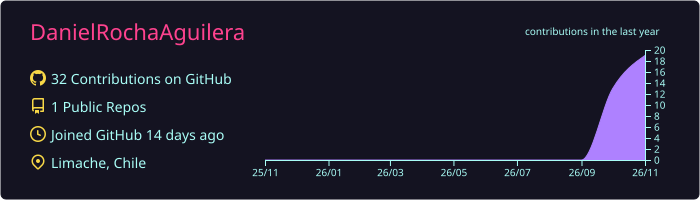
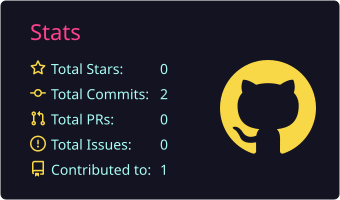
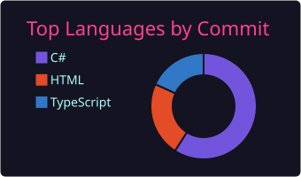

<!-- ═══════════════════════════ BANNER ═══════════════════════════ -->

  

  

  
  
  
  

  

## 👨‍💻 Sobre mí · About me

<table>
<tr>
<td width="50%" valign="top">

### 🇨🇱 Español

Ingeniero de Ejecución en Computación e Informática con **más de 15 años de experiencia** en desarrollo de software, integración de sistemas, arquitectura de software y liderazgo técnico.

Me especializo en **C#, .NET, Entity Framework, arquitectura limpia, principios SOLID, patrones de diseño, arquitectura cloud y metodologías ágiles**. He trabajado en proyectos de alto impacto en las industrias de **tecnología, comercio, gobierno y salud**, mejorando la eficiencia operativa y la calidad de los servicios con soluciones escalables y orientadas al negocio.

Busco aportar a equipos de desarrollo en entornos desafiantes, proponiendo mejoras continuas en sistemas críticos y estrategias de automatización.

</td>
<td width="50%" valign="top">

### 🌎 English

Computer Engineer with **15+ years of experience** in software development, systems integration, software architecture and technical leadership.

I specialize in **C#, .NET, Entity Framework, clean architecture, SOLID principles, design patterns, cloud architecture and agile methodologies**. I have worked on high-impact projects across **technology, retail, government and healthcare**, improving operational efficiency and service quality through scalable, business-oriented solutions.

I enjoy joining development teams in challenging environments, driving continuous improvement of critical systems and automation strategies.

</td>
</tr>
</table>

## 🎨 Tecnologías · Tech stack

<table>
<tr>
<td width="50%" valign="top">

#### 💗 Frontend & Mobile

#### 💜 Backend

#### 💙 Datos · Data

</td>
<td width="50%" valign="top">

#### 🧡 Infra & DevOps

#### 💚 Calidad & Herramientas

#### 💛 Arquitectura · Architecture

</td>
</tr>
</table>

## 🧭 Cómo trabajo · How I work

<table>
<tr>
<td align="center" width="33%">
<h3>🏛️</h3>
<b>Arquitectura limpia y en capas</b> 
Principios SOLID y patrones de diseño  
<i>Clean, layered architecture, SOLID principles and design patterns</i>
</td>
<td align="center" width="33%">
<h3>🧩</h3>
<b>Microservicios desacoplados</b> 
Detrás de un API Gateway  
<i>Decoupled microservices behind an API Gateway</i>
</td>
<td align="center" width="33%">
<h3>🔐</h3>
<b>Seguridad desde el diseño</b> 
JWT, acceso por perfil, auditoría y cifrado de datos sensibles  
<i>Security by design: JWT, role-based access, audit logging and encryption of sensitive data</i>
</td>
</tr>
<tr>
<td align="center" width="33%">
<h3>📦</h3>
<b>Contenedores y orquestación</b> 
Docker y Kubernetes, también en redes internas sin internet  
<i>Containers and orchestration with Docker and Kubernetes, including air-gapped networks</i>
</td>
<td align="center" width="33%">
<h3>🔗</h3>
<b>Modernización de legados</b> 
Integración de sistemas legados hacia plataformas modernas y cloud  
<i>Integration and modernization of legacy systems into modern and cloud platforms</i>
</td>
<td align="center" width="33%">
<h3>🤝</h3>
<b>Agilidad y liderazgo</b> 
Metodologías ágiles y liderazgo técnico de equipos  
<i>Agile methodologies and technical team leadership</i>
</td>
</tr>
</table>

## 🏆 Logros destacados · Key achievements

<table>
<tr>
<td width="20%" align="center"><h2>⚡ −35%</h2>🟪🟪🟪🟪⬛⬛⬛⬛⬛⬛</td>
<td>Tiempo de generación de documentos tributarios, migrando procesos de <b>VBA a AWS Lambda</b> <i>Tax-document generation time by migrating VBA processes to AWS Lambda</i></td>
</tr>
<tr>
<td align="center"><h2>📈 +40%</h2>🟦🟦🟦🟦⬛⬛⬛⬛⬛⬛</td>
<td>Eficiencia operativa con un <b>sistema de gestión de remates en línea</b> <i>Operational efficiency with an online auction management system</i></td>
</tr>
<tr>
<td align="center"><h2>🚗 −50%</h2>🟩🟩🟩🟩🟩⬛⬛⬛⬛⬛</td>
<td>Tiempo de verificación legal de vehículos, <b>automatizando el flujo de validación</b> <i>Vehicle legal-verification time by automating the validation workflow</i></td>
</tr>
<tr>
<td align="center"><h2>🌱 −60%</h2>🟨🟨🟨🟨🟨🟨⬛⬛⬛⬛</td>
<td>Tiempo de ingreso de datos de un <b>formulario de declaración ambiental</b> (.NET MVC) <i>Data-entry time for an environmental compliance form (.NET MVC)</i></td>
</tr>
<tr>
<td align="center"><h2>🛒 +45%</h2>🟧🟧🟧🟧🟧⬛⬛⬛⬛⬛</td>
<td>Trazabilidad y estabilidad en una <b>plataforma B2B de pedidos</b>, con un backend desacoplado <i>Traceability and stability of a B2B ordering platform through a decoupled backend</i></td>
</tr>
</table>

## 💼 Trayectoria · Experience

| Período | Dónde · Where | Rol y foco · Role & focus |
|:--:|:--:|:--|
|  | 🚀 **Proyectos propios** | Angular, Flutter, Node.js, .NET, AWS, Docker y GitHub Actions; arquitectura de microservicios para el sector salud. |
|  | 🟣 **Nubox** | Ingeniero de Software Semi Senior: integración de sistemas legados (VBA, ASP clásico, COM) con C#, y microservicios en AWS. |
|  | 🔵 **Remates Macal** | Ingeniero de Software y luego Senior: lideré el equipo de Desarrollo y Continuidad Operacional. |
|  | 🟠 **Consultoría** | Gobierno, salud, banca y retail: SAG, SENCE, Superintendencia del Medio Ambiente, Isapre Cruz Blanca, AFP Habitat, ING Capital, Salcobrand. |

## 🚀 Proyecto destacado · Featured project

  <b>🏥 Ecosistema clínico para enfermería</b> · <i>Clinical nursing platform</i> 
  

  Plataforma que digitaliza el registro de ingreso y alta de pacientes que antes se hacía en papel. 
  <i>Platform that digitizes patient admission and discharge records previously kept on paper.</i>

<table>
<tr>
<td width="50%" valign="top">

### 🏗️ Arquitectura
Microservicios .NET en capas, API Gateway con Ocelot y portal web en Angular. 
<i>Layered .NET microservices, Ocelot API Gateway and an Angular web portal.</i>

</td>
<td width="50%" valign="top">

### 🔐 Seguridad
Autenticación JWT, permisos por perfil, registro de auditoría inmutable y cifrado AES-256 de firmas, en línea con la normativa chilena de protección de datos. 
<i>JWT authentication, role-based permissions, immutable audit log and AES-256 encryption of signatures, aligned with Chilean data-protection law.</i>

</td>
</tr>
<tr>
<td width="50%" valign="top">

### 🩺 Clínico
Escalas geriátricas con cálculo automático, resumen para el sistema clínico con un clic, firma en pantalla y PDF del alta. 
<i>Automatic geriatric scales, one-click summary for the clinical record system, on-screen signatures and discharge PDF.</i>

</td>
<td width="50%" valign="top">

### 📦 Despliegue
Docker y Kubernetes en red interna, con secretos gestionados fuera del código. 
<i>Docker and Kubernetes on an internal network, with secrets managed outside the code.</i>

</td>
</tr>
</table>

## 📊 Estadísticas · GitHub stats

<!-- Tarjetas generadas a diario por .github/workflows/profile-cards.yml (tema radical) -->

  

  
  

  

## 🎓 Formación · Education

| | Programa · Program | Institución | Año |
|:--:|:--|:--|:--:|
| ☁️ | **Diplomado en Modernización de la Arquitectura de Software y Cloud** | Lite Thinking |  |
| 🏅 | **Scrum Foundation Professional Certificate (SFPC)** | AgileChile |  |
| 🔄 | **Product Owner / Scrum Master / DevOps Essentials** | AgileChile |  |
| 🎓 | **Ingeniería de Ejecución en Computación e Informática** | Universidad de Aconcagua |  |
| 💻 | **Técnico Analista Programador** | Universidad de Aconcagua |  |

<!-- ═══════════════════════════ FOOTER ═══════════════════════════ -->

  

